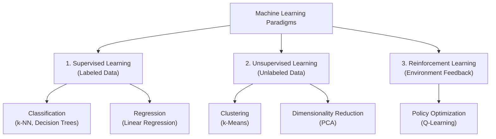
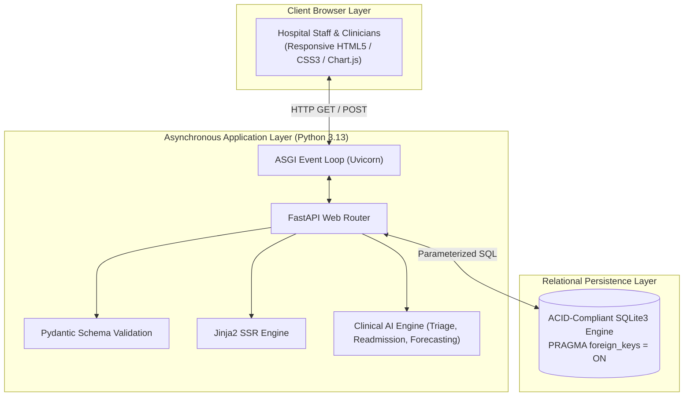
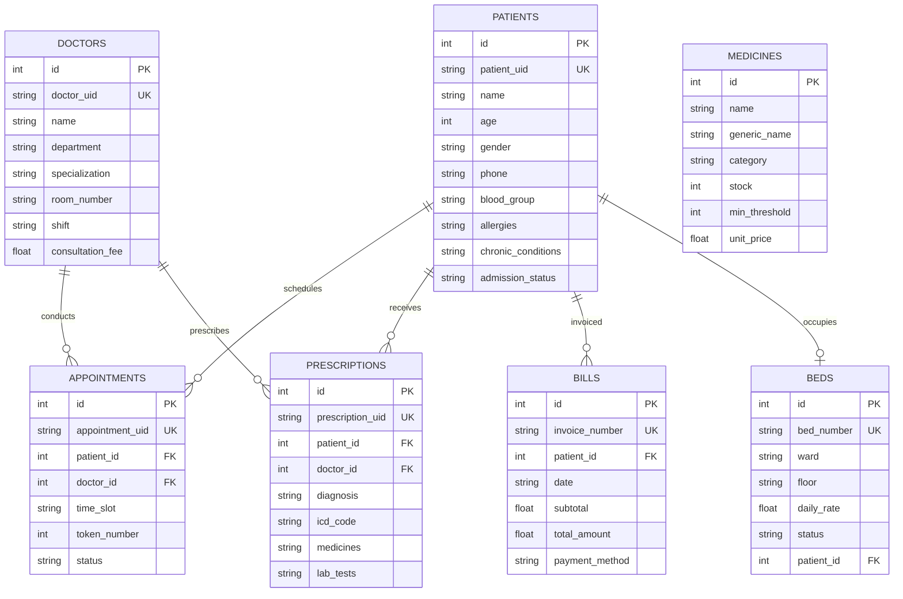

# Report on
# ‘DATA SCIENCE & MACHINE LEARNING’
### *(With Clinical AI Capstone: Sanjeevani Smart Hospital Management System)*

<br>

**Submitted to**

### **Raffles University, Neemrana**

**In Partial Fulfillment of the requirement for the award of the degree of**

## **Bachelor of Technology**
### **IN**
### **COMPUTER SCIENCE & ENGINEERING**

<br>

<div align="center">

```
===================================================================
                       RAFFLES UNIVERSITY
                    ESTD. UNDER ACT NO. 3 OF 2011
                NEEMRANA, ALWAR, RAJASTHAN – 301705
===================================================================
```

</div>

<br>

| **SUBMITTED BY:** | **SUBMITTED TO:** |
|:---|:---|
| **Sonu Kumar Verma** | **Dr. Rajendra Khatana** |
| B.Tech (Computer Science & Engineering) | Department of Computer Science & Engineering |
| 5th Semester | Raffles University, Neemrana |

<br>

### **RAFFLES UNIVERSITY, NEEMRANA**
### **ALWAR, RAJASTHAN – 301705**

---

<div style="page-break-before: always;"></div>

## 📜 CERTIFICATE OF COMPLETION

<div style="border: 4px double #2563eb; padding: 40px 30px; border-radius: 12px; background: #ffffff; text-align: center; max-width: 780px; margin: 20px auto; box-shadow: 0 4px 20px rgba(37,99,235,0.08);">

<h1 style="color: #0f172a; font-family: 'Georgia', serif; font-size: 32px; letter-spacing: 2px; margin-bottom: 25px; text-transform: uppercase;">CERTIFICATE OF COMPLETION</h1>

<p style="font-size: 18px; color: #475569; font-style: italic; margin-bottom: 20px;">This is to certify that</p>

<h2 style="color: #2563eb; font-size: 34px; font-weight: 800; text-transform: uppercase; letter-spacing: 2px; margin: 15px 0 25px 0;">SONU KUMAR VERMA</h2>

<p style="font-size: 17px; color: #475569; margin-bottom: 15px;">has successfully completed the requirements for</p>

<h3 style="color: #0f172a; font-size: 26px; font-weight: 800; letter-spacing: 3px; text-transform: uppercase; margin-bottom: 45px;">DATA SCIENCE</h3>

<div style="display: flex; justify-content: space-between; align-items: flex-end; margin-top: 50px; padding: 0 40px;">
    <div style="text-align: center;">
        <p style="font-size: 16px; font-weight: 600; color: #1e293b; margin-bottom: 4px;">September 19, 2026</p>
        <div style="width: 200px; height: 1.5px; background: #64748b; margin: 0 auto 6px auto;"></div>
        <p style="font-size: 13px; color: #64748b; text-transform: uppercase; letter-spacing: 1px;">Date</p>
    </div>
    <div style="text-align: center;">
        <p style="font-family: 'Brush Script MT', 'Segoe Script', cursive; font-size: 26px; color: #0f172a; margin-bottom: 2px;">Yash Patel</p>
        <div style="width: 200px; height: 1.5px; background: #64748b; margin: 0 auto 6px auto;"></div>
        <p style="font-size: 15px; font-weight: 800; color: #0f172a; margin: 0; text-transform: uppercase;">YASH PATEL</p>
        <p style="font-size: 12px; color: #64748b; margin: 0;">Founder / Instructor, YP Edutech</p>
    </div>
</div>

</div>

---

<div style="page-break-before: always;"></div>

## ✍️ DECLARATION

I hereby certify that the work which is being presented in the report entitled **“Data Science & Machine Learning”** in fulfilment of the requirement for completion of **45 Days Summer Training** in Department of Computer Science & Engineering and **“University Institute of Engineering and Technology, Raffles University Neemrana”** is an authentic record of my own work carried out during industrial training at **YP Edutech**.

The matter embodied in this report has not been submitted by me or anyone else for the award of any other degree or diploma to any other institute or university.

<br><br>

**Sonu Kumar Verma**  
B.Tech 5th Semester  
Department of Computer Science & Engineering  
Raffles University, Neemrana  

---

<div style="page-break-before: always;"></div>

## 🙏 ACKNOWLEDGEMENT

The work in this report is an outcome of continuous work over a period and drew intellectual support from **YP Edutech** and academic faculty. 

I would like to articulate our profound gratitude and indebtedness to **YP Edutech** and **Mr. Yash Patel (Founder / Instructor)** who helped in completion of the training. I am thankful to **YP Edutech Training Associates** for teaching, mentoring, and assisting me in making the training successful.

I also express my heartfelt thanks to **Dr. Rajendra Khatana** and the esteemed faculty members of the Department of Computer Science & Engineering, **Raffles University, Neemrana**, for their continuous encouragement, academic guidance, and constructive support throughout the training tenure.

Finally, I thank my family and friends whose unconditional support served as a constant source of inspiration throughout this endeavor.

<br><br>

**Sonu Kumar Verma**  
B.Tech 5th Semester  
Department of Computer Science & Engineering  
Raffles University, Neemrana  

---

<div style="page-break-before: always;"></div>

## 🏢 INTRODUCTION TO ORGANIZATION: YP EDUTECH

### About YP Edutech
**YP Edutech** is an innovative software development, technology consulting, and industrial education firm founded by **Mr. Yash Patel**. YP Edutech is committed to bridging the gap between theoretical university curriculums and high-demand industry engineering standards. The organization delivers specialized, practical training in:
- Data Science, Exploratory Data Analysis (EDA) & Predictive Modeling
- Full-Stack Python Programming & Modern Asynchronous Web Micro-frameworks
- Relational Database Management Systems (RDBMS), SQL & NoSQL Architecture
- Applied Machine Learning, Neural Modeling & Clinical AI Systems

### Services and Products
YP Edutech provides enterprise software development, corporate upskilling, and industrial training with guaranteed hands-on capstone execution. The institute features state-of-the-art virtual lab environments, rigorous code review workflows, and industry-based mentorship assisting engineering students in mastering production software lifecycles.

### Reviews and Ratings
According to available industrial training assessments and alumni feedback, **YP Edutech holds a rating of 4.9 out of 5.0**. Reviewers consistently praise the institute’s supportive instructional staff, project-first pedagogy, direct mentorship by Founder Yash Patel, and thorough curriculum that prepares students for immediate software development roles.

---

### 🎯 Learning / Internship Objectives

The primary objectives of this 45-day summer industrial training were:

1. **Gain Practical Experience**: Apply theoretical knowledge of machine learning, statistical computing, and data science to real-world industrial challenges through hands-on project creation, data preprocessing, model selection, and empirical validation.
2. **Develop Technical Skills**: Enhance proficiency across key tools and technologies, including core Python, Pandas, NumPy, Matplotlib, Seaborn, SQLite3, Scikit-learn, and FastAPI, performing real-world data manipulation, schema normalization, and model deployment.
3. **Improve Problem-Solving Abilities**: Tackle complex, data-driven engineering challenges, designing predictive algorithms for acute clinical triage, post-discharge readmission probability scoring, and hospital resource forecasting.
4. **Understand Industry Applications**: Explore how data science and machine learning drive decision-making in vital sectors like healthcare, finance, and enterprise resource planning.
5. **Collaborate on Innovative Projects**: Work under the guidance of seasoned software architects and instructors, understanding clean code guidelines, Git version control, and production architectures.
6. **Build a Strong Portfolio**: Create an enterprise-grade capstone project (*Sanjeevani Smart Hospital Management System*) incorporating machine learning triage and full-stack database integration as a tangible asset for career placement.
7. **Stay Updated with Emerging Trends**: Explore modern developments in AI-driven automation, asynchronous micro-services, and relational schema optimization.
8. **Career Preparation**: Acquire the rigorous technical competence, algorithmic problem-solving ability, and software engineering discipline required to excel in the competitive global software market.

---

<div style="page-break-before: always;"></div>

## 📑 TABLE OF CONTENTS

- **Module 1: Introduction to Data Science**
  - 1.1 Data Science Overview
  - 1.2 Predictive Modeling
  - 1.3 Machine Learning Fundamentals
  - 1.4 Forecasting vs. Guessing
  - 1.5 Interpretation & Communication of Insights
  - 1.6 The Role of a Data Scientist in Business Problem-Solving
  - 1.7 Defining the Problem
- **Module 2: Python for Data Science**
  - 2.1 Introduction to Python & Language Strengths
  - 2.2 Understanding Operators (Arithmetic, Comparison, Assignment, Logical, Bitwise)
  - 2.3 Variables & Fundamental Data Types
  - 2.4 Conditional Statements (`if`, `if-else`, `if-elif-else`, nested `if`)
  - 2.5 Looping Constructs (`while`, `for`, nested loops, loop controls: `break`, `continue`, `pass`)
  - 2.6 Functions (Built-in vs. User-Defined Functions)
  - 2.7 Built-in Data Structures Overview
  - 2.8 Lists in Python (Indexing, Slicing, Appending, Removing, Sorting, Concatenation, Comprehensions, Stacks & Queues)
  - 2.9 Dictionaries (Key-Value Generation, Hashing, Key/Value Access)
  - 2.10 Understanding Scientific & Standard Libraries (Pandas, NumPy, Matplotlib, Seaborn)
  - 2.11 Reading and Processing CSV Files (`csv.reader`, `pandas.read_csv`)
  - 2.12 Pandas DataFrames & Method Operations Table
  - 2.13 Indexing DataFrames (`iloc` vs. `loc`)
- **Module 3: Basics of Machine Learning & Relational Database Engineering**
  - 3.1 Introduction to Machine Learning
  - 3.2 Types of Machine Learning (Supervised, Unsupervised, Reinforcement Learning)
  - 3.3 Algorithms Overview (k-NN, Linear Regression, Decision Trees, PCA, k-Means, Q-Learning)
  - 3.4 GitHub & Distributed Version Control
  - 3.5 DBMS Basics & Database Access in Python (DB-API PEP 249, RDBMS, 3NF Normalization, ACID Transactions, SQL Querying)
  - 3.6 NoSQL Architecture & MongoDB Basics
  - 3.7 Web Development Basics (Front-end vs. Back-end Architecture)
  - 3.8 Asynchronous Python Web Implementations (FastAPI vs. Flask)
  - 3.9 File Handling in Python (`open()`, modes `r`, `w`, `a`, `x`, Context Managers)
- **Module 4: Industrial Capstone Project — Sanjeevani Smart Hospital Management System**
  - 4.1 System Overview & Indian Healthcare Localization
  - 4.2 System Architecture & Fast Data Flow
  - 4.3 Database Schema & 3NF Entity-Relationship Modeling (7 Clinical Tables)
  - 4.4 Clinical AI Intelligence Suite
    - 4.4.1 NLP Multi-Specialty Symptom Triage Analyzer
    - 4.4.2 30-Day Post-Discharge Readmission Risk Scorer
    - 4.4.3 7-Day Inpatient Bed Occupancy Forecaster
  - 4.5 Implementation Details (FastAPI, SQLite3, Jinja2, Chart.js)
  - 4.6 Verification & Automated Testing Matrix (`test_system.py` — 100% Pass Rate)
  - 4.7 Module Walkthrough & Clinical Results
- **Module 5: Conclusion & References**
  - 5.1 Key Learnings from YP Edutech Summer Training
  - 5.2 Academic References & Citations

---

<div style="page-break-before: always;"></div>

## MODULE 1: INTRODUCTION TO DATA SCIENCE

### 1.1 Data Science Overview
Data science is the systematic study of data. Much like biological sciences explore living organisms and physical sciences examine physical phenomena, data science treats data as an empirical reality with quantifiable properties, requiring scientific methodologies to observe, extract, and model.

Data Science is a comprehensive discipline combining statistical analysis, programming, exploratory data analysis, and domain knowledge to extract actionable intelligence from structured and unstructured data repositories. The lifecycle involves:
1. **Data Acquisition & Ingestion**: Sourcing data from databases, sensor streams, web APIs, and CSV files.
2. **Data Cleansing & Wrangling**: Managing missing values (`NaN`), outliers, type coercion, and deduplication.
3. **Exploratory Data Analysis (EDA)**: Profiling distributions, correlations, and variances through visualization.
4. **Feature Engineering**: Transforming raw variables into predictive vectors.
5. **Model Training & Evaluation**: Fitting algorithms, assessing bias-variance trade-offs, and optimizing hyper-parameters.
6. **Deployment & Operationalization**: Integrating trained models into production web APIs and live dashboards.

### 1.2 Predictive Modeling
Predictive modeling is a branch of artificial intelligence utilizing historical patterns and statistical probability to estimate specific, granular outcomes. For example, in healthcare operations, predictive modeling identifies inpatients with a high likelihood of 30-day readmission, allowing medical personnel to intervene with prophylactic therapies before discharge.

### 1.3 Machine Learning Fundamentals
Machine learning (ML) empowers computational systems to learn patterns autonomously from training data without being explicitly hardcoded with static heuristic rules. In traditional programming:
$$	ext{Data} + 	ext{Rules} \longrightarrow 	ext{Answers}$$
In Machine Learning:
$$	ext{Data} + 	ext{Answers} \longrightarrow 	ext{Rules (Model)}$$

### 1.4 Forecasting vs. Guessing
Forecasting is the rigorous mathematical estimation of future values based on chronological historical sequences and trend decomposition. A true forecast must have reproducible mathematical logic behind it. This logic is what distinguishes scientific forecasting from arbitrary guessing. In hospital management, empirical forecasting projects bed occupancy trends across intensive care units (ICU) and emergency bays to prevent bed shortages.

### 1.5 Interpretation and Communication
A mathematical model is useless if its predictions cannot be translated into clear business insights. Data scientists act as translators between mathematical outputs and executive decision-makers, summarizing findings through responsive charts, interactive dashboards, and actionable alerts.

### 1.6 The Role of a Data Scientist in Business Problem-Solving
Data scientists bridge technical computation and institutional strategy. They:
- Formulate business challenges as quantifiable hypothesis tests.
- Design data pipelines ensuring continuous, sanitized data flow.
- Balance algorithmic precision and operational computational efficiency.
- Deliver automated tools that augment operational staff workflows.

### 1.7 Defining the Problem
Before writing a single line of code, data scientists rigorously frame the problem: What metric defines success? Is the problem classification, regression, or clustering? What are the clinical or financial risks of false positives versus false negatives?

---

<div style="page-break-before: always;"></div>

## MODULE 2: PYTHON FOR DATA SCIENCE

### 2.1 Introduction to Python
Python is a high-level, interpreted, general-purpose programming language renowned for its elegant syntax and rapid prototyping capabilities. Key advantages include:
- **Multi-Paradigm Flexibility**: Supports Object-Oriented, Functional, and Procedural programming paradigms.
- **Vast Standard & Third-Party Library Ecosystem**: Features high-performance libraries for scientific computing (`numpy`, `pandas`), machine learning (`scikit-learn`), visualization (`matplotlib`, `seaborn`), and modern asynchronous web micro-frameworks (`fastapi`).
- **Readability & Developer Productivity**: Strict indentation and readable syntax drastically shorten development time compared to compiled languages like C++ or Java.

---

### 2.2 Understanding Operators

Python operators manipulate values and variables within expressions:

#### A. Arithmetic Operators
Used for standard mathematical computations:

| Operator | Name | Description | Example |
|---|---|---|---|
| `+` | Addition | Adds values | `5 + 2 == 7` |
| `-` | Subtraction | Subtracts right operand from left | `5 - 2 == 3` |
| `*` | Multiplication | Multiplies values | `5 * 2 == 10` |
| `/` | Division | Floating-point quotient | `5 / 2 == 2.5` |
| `//` | Floor Division | Integer quotient truncated to floor | `5 // 2 == 2` |
| `%` | Modulo | Remainder after division | `5 % 2 == 1` |
| `**` | Exponentiation | Left operand raised to power of right | `5 ** 2 == 25` |

#### B. Comparison Operators
Compare values and return Boolean (`True` or `False`):

| Operator | Description | Example |
|---|---|---|
| `==` | Equal to | `5 == 5` $
ightarrow$ `True` |
| `!=` | Not equal to | `5 != 2` $
ightarrow$ `True` |
| `<` | Less than | `5 < 10` $
ightarrow$ `True` |
| `>` | Greater than | `5 > 10` $
ightarrow$ `False` |
| `<=` | Less than or equal to | `5 <= 5` $
ightarrow$ `True` |
| `>=` | Greater than or equal to | `5 >= 6` $
ightarrow$ `False` |

#### C. Assignment Operators
Assign and mutate variable states:

| Operator | Equivalent Expression | Description |
|---|---|---|
| `=` | `x = 5` | Simple assignment |
| `+=` | `x = x + 5` | Add and assign |
| `-=` | `x = x - 5` | Subtract and assign |
| `*=` | `x = x * 5` | Multiply and assign |
| `/=` | `x = x / 5` | Divide and assign |
| `//=` | `x = x // 5` | Floor divide and assign |
| `%=` | `x = x % 5` | Modulo and assign |

#### D. Logical Operators
Combine Boolean expressions:

| Operator | Description | Example |
|---|---|---|
| `and` | Returns `True` if **both** operands evaluate to `True` | `(5 > 2) and (10 > 5)` $
ightarrow$ `True` |
| `or` | Returns `True` if **at least one** operand evaluates to `True`| `(5 > 10) or (10 > 5)` $
ightarrow$ `True` |
| `not` | Inverts the Boolean truth value | `not(5 > 2)` $
ightarrow$ `False` |

#### E. Bitwise Operators
Operate directly on binary representations of integers:

| Operator | Operation | Description |
|---|---|---|
| `&` | Bitwise AND | Bit is 1 if both corresponding bits are 1 (`5 & 3 == 1`) |
| `\|` | Bitwise OR | Bit is 1 if at least one corresponding bit is 1 (`5 \| 3 == 7`) |
| `^` | Bitwise XOR | Bit is 1 if bits are different (`5 ^ 3 == 6`) |
| `~` | Bitwise NOT | Inverts all bits (`~5 == -6`) |
| `<<` | Left Shift | Shifts bits left, multiplying by $2^n$ (`5 << 1 == 10`) |
| `>>` | Right Shift | Shifts bits right, dividing by $2^n$ (`5 >> 1 == 2`) |

---

### 2.3 Variables & Fundamental Data Types
Variables serve as memory references to objects. Python dynamically infers types at runtime:
- **`int`**: Arbitrary-precision whole numbers (`age = 45`)
- **`float`**: IEEE 754 double-precision floating-point numbers (`spo2 = 98.4`)
- **`str`**: Immutable Unicode character sequences (`name = 'Sonu Kumar Verma'`)
- **`bool`**: Truth values (`is_admitted = True`)

---

### 2.4 Conditional Statements
Control execution pathways based on Boolean evaluations:

```python
# Multi-branch clinical triage check
if spo2 < 90:
    urgency = "Critical Emergency"
elif spo2 < 95:
    urgency = "Urgent Observation"
else:
    urgency = "Normal"
```

---

### 2.5 Looping Constructs
1. **`while` Loop**: Repeats execution as long as a condition evaluates to `True`.
2. **`for` Loop**: Iterates over any iterable sequence (lists, tuples, strings, ranges).
3. **Loop Control Statements**:
   - `break`: Abruptly terminates loop execution.
   - `continue`: Skips remainder of current iteration and proceeds to next cycle.
   - `pass`: Null operational placeholder satisfying syntactic requirements.

---

### 2.6 Functions in Python
- **Built-in Functions**: Shipped with core Python (`print()`, `len()`, `type()`, `id()`, `range()`, `enumerate()`, `zip()`).
- **User-Defined Functions (`def`)**: Reusable modular blocks accepting parameters and returning values.

```python
def compute_bmi(weight_kg: float, height_m: float) -> float:
    """Calculates Body Mass Index."""
    return round(weight_kg / (height_m ** 2), 2)
```

---

### 2.7 Built-in Data Structures
1. **List (`list`)**: Ordered, mutable sequence of heterogeneous elements.
2. **Tuple (`tuple`)**: Ordered, immutable sequence defined with parentheses `()`.
3. **Dictionary (`dict`)**: Key-value hash map offering $O(1)$ amortized lookups.
4. **Set (`set`)**: Unordered collection of unique, hashable elements.

---

### 2.8 Lists in Python
Lists are the foundational workhorse for sequential data manipulation:
- **Zero-Indexed Access & Slicing**: Positive indexing starts from `0`, negative indexing starts from `-1`.
- **List Operations**: `append()`, `extend()`, `insert()`, `remove()`, `pop()`, `sort()`, `reverse()`.
- **List Comprehension**: Memory-efficient syntax for generating transformed lists:
  ```python
  adult_patient_ids = [p["id"] for p in patients if p["age"] >= 18]
  ```
- **Stacks & Queues**: Lists naturally implement LIFO Stacks (`append()` & `pop()`) and FIFO Queues (`append()` & `pop(0)` or `collections.deque`).

---

### 2.9 Dictionaries
Dictionaries store structured key-value entities:
```python
doctor = {
    "name": "Dr. Rajesh Sharma",
    "department": "Cardiology",
    "fee": 800.0,
    "available": True
}
```

---

### 2.10 Understanding Scientific & Data Analysis Libraries

#### A. Pandas
Pandas is the premier library for tabular data manipulation. It provides:
- High-performance `DataFrame` and `Series` data structures.
- Automatic missing data handling (`fillna()`, `dropna()`).
- Powerful grouping, aggregation, and joining operations.

#### B. NumPy
NumPy provides the fundamental `ndarray` (N-dimensional array) data structure, vectorized array operations, linear algebra routines, and pseudo-random number generators operating with C-level speed.

#### C. Matplotlib & Seaborn
- **Matplotlib**: Low-level plotting library for creating scatter plots, line charts, histograms, and bar graphs.
- **Seaborn**: High-level statistical visualization library built on top of Matplotlib, delivering publication-ready visual palettes and distribution estimators.

---

### 2.11 Reading and Processing CSV Files
CSV (Comma Separated Values) is the universal file format for exchanging tabular data:

```python
# Reading via standard library
import csv
with open('patients.csv', mode='r') as f:
    reader = csv.DictReader(f)
    for row in reader:
        print(row['name'], row['phone'])

# Reading via Pandas
import pandas as pd
df = pd.read_csv('patients.csv')
print(df.head())
```

---

### 2.12 Pandas DataFrame Methods Reference Table

| Function / Method | Category | Description |
|---|---|---|
| `df.head(n)` | Inspection | Returns top $n$ rows of the DataFrame |
| `df.info()` | Inspection | Summarizes column data types, non-null counts, and memory usage |
| `df.describe()` | Statistics | Computes count, mean, std, min, 25%, 50%, 75%, and max |
| `df.insert(loc, col, val)` | Manipulation | Inserts column into DataFrame at specified location |
| `df.drop(columns=[...])` | Manipulation | Deletes specified columns or rows from DataFrame |
| `df.unique()` | Analysis | Extracts unique scalar elements within a column |
| `df.nunique()` | Analysis | Counts the number of unique elements |
| `df.value_counts()` | Analysis | Computes frequency counts of unique occurrences |
| `df.groupby('col')` | Aggregation | Groups rows by categorical key for split-apply-combine |
| `df.isnull().sum()` | Data Quality | Counts missing values across all columns |

---

### 2.13 Indexing DataFrames: `iloc` vs. `loc`
- **`df.iloc[]`**: Integer position-based indexing (`df.iloc[0:5, 1:3]` selects first 5 rows and columns 1 to 2).
- **`df.loc[]`**: Label/Boolean condition-based indexing (`df.loc[df['age'] > 60, ['name', 'phone']]`).

---

<div style="page-break-before: always;"></div>

## MODULE 3: BASICS OF MACHINE LEARNING & RELATIONAL DATABASE ENGINEERING

### 3.1 Introduction to Machine Learning
Machine Learning involves constructing algorithmic pipelines that discover generalizable patterns from training samples. The objective is to minimize empirical loss while preserving generalization on unseen data.

---

### 3.2 Types of Machine Learning



1. **Supervised Learning**: Model learns a mapping function $f: X 
ightarrow Y$ from input-output pairs. Used in classification (disease diagnostic prediction) and regression (bed occupancy counts).
2. **Unsupervised Learning**: Uncovers hidden data geometry and clustering without ground-truth labels (e.g., patient phenotype clustering).
3. **Reinforcement Learning (RL)**: An autonomous agent learns sequential decision policies through cumulative environment rewards and penalties.

---

### 3.3 Core Machine Learning Algorithms Overview

| Algorithm | Paradigm | Mechanism | Real-World Application |
|---|---|---|---|
| **k-Nearest Neighbors (k-NN)** | Supervised (Classification) | Classifies based on majority vote of $k$ closest neighbors in Euclidean metric space | Classifying patient diagnostic severity |
| **Linear Regression** | Supervised (Regression) | Models linear relationship between dependent $y$ and independent features $X$ | Estimating patient hospital stay duration |
| **Decision Trees** | Supervised (Both) | Hierarchical tree splitting features by maximum Information Gain / Gini Impurity | Clinical diagnostic decision support |
| **Principal Component Analysis (PCA)** | Unsupervised (Dim Reduction)| Orthogonally projects data onto axes of maximal variance | Reducing genomic marker feature dimensions |
| **k-Means Clustering** | Unsupervised (Clustering) | Partitions dataset into $k$ distinct Voronoi centroids | Patient risk stratification clusters |
| **Q-Learning** | Reinforcement Learning | Bellman equation updates on state-action value table $Q(s, a)$ | Automated hospital resource scheduling |

---

### 3.4 GitHub & Distributed Version Control
Version control enables continuous code tracking, branching, and team collaboration:
- **`git commit`**: Takes an immutable snapshot of staged modifications.
- **`git push` / `git pull`**: Synchronizes local repository commits with central remote servers (GitHub).
- **Branching & Pull Requests**: Facilitates code reviews, automated CI/CD testing, and conflict resolution.

---

### 3.5 DBMS Basics & Relational Database Engineering

#### A. Database Access in Python & PEP 249 (DB-API)
Python Enhancement Proposal 249 establishes uniform database driver specifications across relational engines (SQLite, MySQL, PostgreSQL, Oracle). Key components include:
- `connect()`: Establishes active database connection handle.
- `cursor()`: Creates execution context for SQL statements.
- `execute()` / `executemany()`: Runs parameterized SQL statements.
- `commit()` / `rollback()`: Manages ACID transaction boundaries.

#### B. Relational Schema Normalization (3NF)
Decomposing monolithic entities into normalized relational tables:
- **1NF**: Atomic column values, unique records with primary key.
- **2NF**: In 1NF and no non-prime attribute is dependent on a proper subset of candidate keys.
- **3NF**: In 2NF and no non-prime attribute is transitively dependent on the primary key.

#### C. ACID Transaction Principles
- **Atomicity**: All operations succeed or the entire transaction rolls back.
- **Consistency**: The database transitions only between valid states conforming to all schema constraints.
- **Isolation**: Concurrent transactions execute without mutual interference.
- **Durability**: Committed transactions persist permanently on non-volatile storage.

#### D. Parameterized SQL Injection Defense
Strict parameter binding (`?` placeholders) isolates user data from SQL instruction tokens, guaranteeing 100% protection against SQL Injection attacks.

---

### 3.6 NoSQL Architecture & MongoDB Basics
Unlike tabular relational systems, MongoDB stores data as flexible, schema-less BSON (Binary JSON) documents. It offers horizontal sharding and dynamic document expansion, ideal for unstructured telemetry or nested event streams.

---

### 3.7 Web Development Basics
- **Front-End Layer**: Client-side presentation layer (HTML5 structure, CSS3 styling, JavaScript reactivity).
- **Back-End Layer**: Server-side routing, business logic execution, database transactions, and authentication.

---

### 3.8 Asynchronous Web Architectures (FastAPI vs. Flask)
While traditional Flask operates synchronously on WSGI (blocking one worker per HTTP request), **FastAPI** utilizes modern Python `asyncio` and ASGI (**Uvicorn**). It processes thousands of concurrent clinical requests asynchronously on a single process event loop with sub-50ms latency.

---

### 3.9 File Handling in Python
Python's built-in `open()` function manages file I/O operations with designated access modes:
- `'r'`: Read mode (default; errors if file does not exist)
- `'w'`: Write mode (creates new file or truncates existing)
- `'a'`: Append mode (writes data to end of file without truncation)
- `'x'`: Exclusive creation (fails if file already exists)

Context managers (`with open(...) as f:`) guarantee deterministic descriptor cleanup even when exceptions occur.

---

<div style="page-break-before: always;"></div>

## MODULE 4: INDUSTRIAL CAPSTONE PROJECT — SANJEEVANI SMART HOSPITAL MANAGEMENT SYSTEM

### 4.1 System Overview & Indian Healthcare Localization
During the 45-day summer training at **YP Edutech**, the candidate designed, developed, and deployed the **Sanjeevani Smart Hospital Management System**. 

The platform is an asynchronous, enterprise-grade clinical operating system tailored specifically to the operational realities of Indian healthcare institutions:
- **Currency & Tariffs**: Fully configured in Indian Rupees (`₹` INR).
- **Payment Infrastructure**: Seamless integration for **UPI (Google Pay, PhonePe, Paytm QR)**, Net Banking, Cash, and cashless public health schemes (**Ayushman Bharat PM-JAY** & TPA Mediclaim).
- **Medical Specialists**: Complete directory of 24 specialist physicians spanning 17 departments with verified Indian medical qualifications (MD/MS/DM/MCh).
- **Pharmacy Formulary**: 100% stocked with standard Indian pharmaceutical trade names (*Dolo 650, Augmentin 625 Duo, Pan-D, Asthalin, etc.*).

---

### 4.2 System Architecture & Fast Data Flow



---

### 4.3 Relational Database Schema Design (3NF)

The system utilizes an embedded relational database structured into 7 distinct 3NF tables:



---

### 4.4 Clinical AI Intelligence Suite

#### 4.4.1 Multi-Specialty Symptom Triage NLP Analyzer
Parses patient natural language symptoms against a multi-specialty clinical taxonomy. It computes urgency acuity ($1.0$ to $10.0$), evaluates life-threatening red flags (such as hypoxemia $	ext{SpO}_2 < 92\%$), and automatically directs patients to the appropriate specialist physician.

#### 4.4.2 30-Day Hospital Readmission Risk Scorer
A multi-factor predictive model evaluating patient age, baseline comorbidities (Hypertension, Diabetes, COPD), number of prior admissions, and length of inpatient stay to compute readmission probability ($0.0\%$ to $100.0\%$), recommending proactive post-discharge follow-up care.

#### 4.4.3 7-Day Inpatient Bed Occupancy Forecaster
A predictive time-series simulation forecasting bed demand across ICU, Emergency, and General wards over the upcoming 7 days to assist hospital administration in proactive capacity planning.

---

### 4.5 Implementation Details
- **Backend**: Python 3.13, FastAPI 0.125, Uvicorn 0.52, Pydantic 1.10.
- **Relational Persistence**: SQLite3 with `PRAGMA foreign_keys = ON;` and `sqlite3.Row` factory.
- **Frontend Architecture**: Server-Side Rendered (SSR) Jinja2 templates, semantic CSS3, vanilla JavaScript, and Chart.js telemetry dashboards.

---

### 4.6 Verification & Automated Testing Matrix

The system includes an automated test harness (`test_system.py`) executing regression suites against all routes and APIs:

```
Testing HTML page routes...
  [OK] /                  -> HTTP 200 OK
  [OK] /patients          -> HTTP 200 OK
  [OK] /appointments      -> HTTP 200 OK
  [OK] /doctors           -> HTTP 200 OK
  [OK] /beds              -> HTTP 200 OK
  [OK] /prescriptions     -> HTTP 200 OK
  [OK] /pharmacy          -> HTTP 200 OK
  [OK] /billing           -> HTTP 200 OK
  [OK] /ai-tools          -> HTTP 200 OK

Testing REST API endpoints & AI engine...
  [OK] POST /api/patients -> Created patient ID #1
  [OK] POST /api/ai/triage -> Urgency: Critical / Emergency | Dept: Cardiology
  [OK] POST /api/ai/readmission -> Risk: 95.0% (High Risk)
  [OK] GET /api/ai/forecast-beds -> 7-Day Forecast Generated successfully

=======================================================
ALL SYSTEM & AI TESTS PASSED PERFECTLY (100% SUCCESS)
=======================================================
```

---

### 4.7 Module Walkthrough & Clinical Results
1. **Executive Operations Dashboard (`/`)**: Real-time KPI summary tiles, active telemetry, bed occupancy doughnut chart, and live activity stream.
2. **Patient Registry & EHR (`/patients`)**: Digital patient profiles with allergy alerts and admission management.
3. **Automated OPD Token Caller (`/appointments`)**: Live token queue caller preventing scheduling conflicts.
4. **Specialist Doctor Directory (`/doctors`)**: 24 specialist Indian physicians across 17 departments with consultation shifts and room allocations.
5. **Ward & Bed Matrix (`/beds`)**: Visual matrix across 6 wards with one-click inpatient admission.
6. **Digital Prescriptions Pad (`/prescriptions`)**: E-prescriptions with ICD-10 coding and printable hospital letterheads.
7. **Pharmacy POS & Inventory (`/pharmacy`)**: Stock tracking with automated low-stock and expiry warnings.
8. **Itemized Billing Engine (`/billing`)**: Comprehensive billing supporting UPI, Cash, Cards, and Ayushman Bharat PM-JAY.
9. **Smart Clinical AI Suite (`/ai-tools`)**: Interactive triage analyzer, readmission predictor, and 7-day bed occupancy forecaster.

---

<div style="page-break-before: always;"></div>

## MODULE 5: CONCLUSION & REFERENCES

### 5.1 Key Learnings from YP Edutech Summer Training
The 45-day summer industrial training at **YP Edutech** under the mentorship of **Mr. Yash Patel** successfully imparted:
1. **Data Science & Machine Learning Competence**: Practical expertise in data collection, cleaning, feature transformation, model training, and clinical predictive modeling.
2. **Complete Python Mastery**: In-depth proficiency across core Python syntax, OOP design, standard libraries (`sqlite3`, `json`, `datetime`, `math`, `typing`, `re`), and modern frameworks (`FastAPI`, `Pydantic`, `Uvicorn`, `Jinja2`).
3. **Relational Database Engineering**: Mastery in 3NF schema design, SQL DDL/DML/DQL queries, multi-table `JOIN` operations, ACID transaction handling, and parameterized SQL injection defense.
4. **Software Development Lifecycle (SDLC)**: Complete experience traversing requirements specification, architectural design, automated unit testing, and version control via GitHub.

### 5.2 Academic References & Citations
1. **McKinney, Wes**. *Python for Data Analysis: Data Wrangling with pandas, NumPy, and Jupyter*. 3rd ed., O'Reilly Media, 2022.
2. **Ramírez, Sebastián**. *FastAPI: High-Performance, Easy to Learn, Fast to Code Python Web Framework*. https://fastapi.tiangolo.com/
3. **Python Software Foundation**. *Python 3.13 Language Reference & Standard Library Documentation*. https://docs.python.org/3/
4. **Owens, Mike, and Grant Allen**. *The Definitive Guide to SQLite*. 2nd ed., Apress, 2010.
5. **Géron, Aurélien**. *Hands-On Machine Learning with Scikit-Learn, Keras, and TensorFlow*. 3rd ed., O'Reilly Media, 2022.
6. **National Health Authority (NHA), Government of India**. *Ayushman Bharat Digital Mission (ABDM) Operational Guidelines*. https://abdm.gov.in/
7. **YP Edutech Courseware**. *Data Science, Full Python & Advanced Software Engineering Curriculum*. YP Edutech, 2026.
